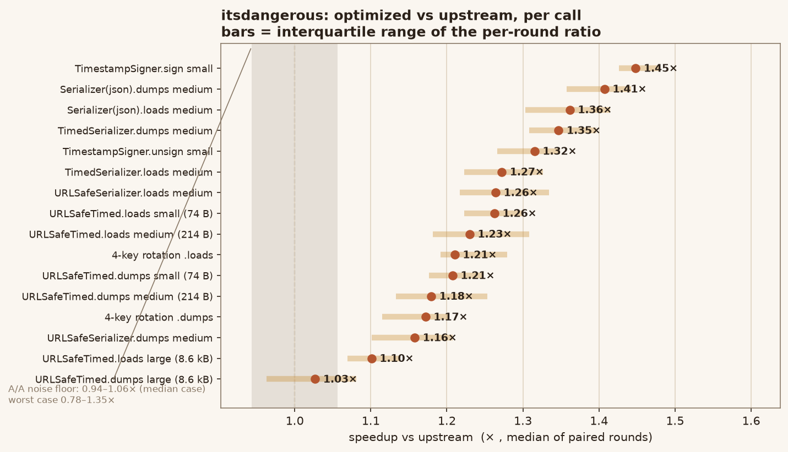
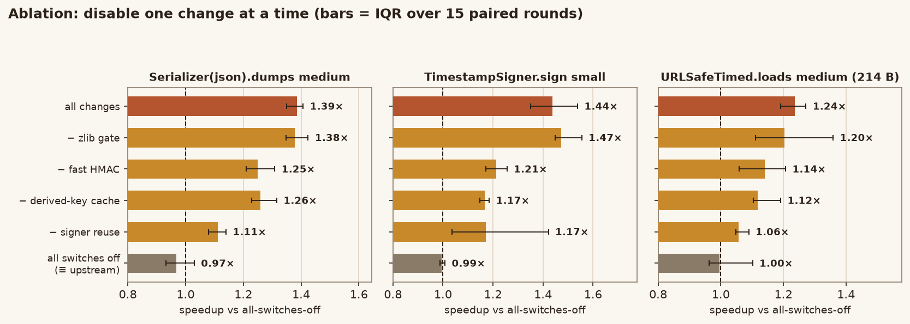
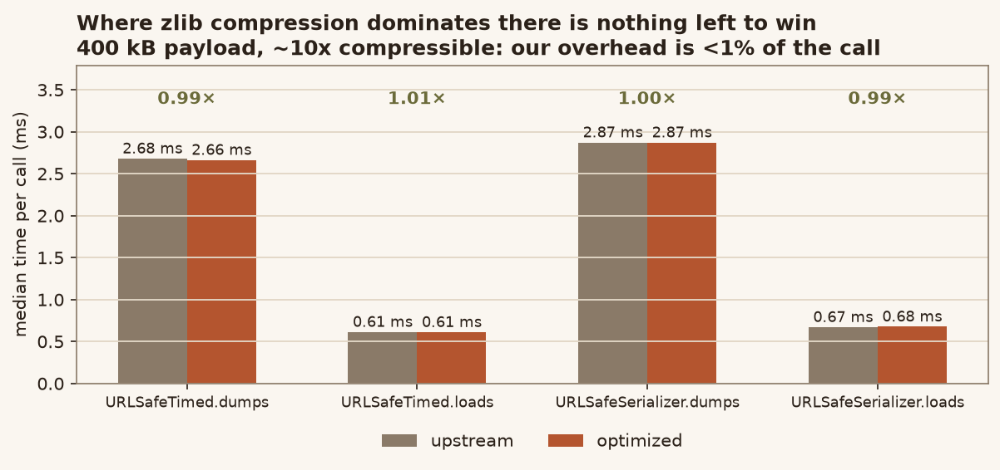
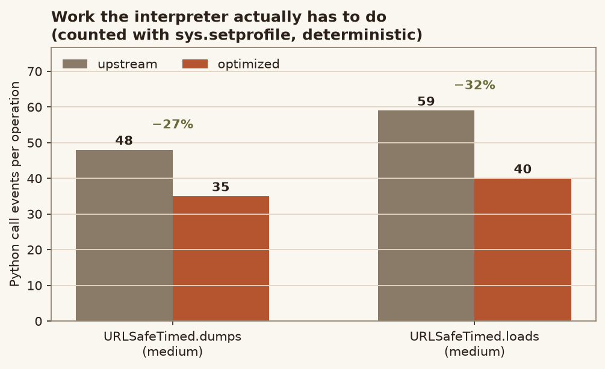

# itsdangerous · faster signing and verification

**A drop-in optimized build of [itsdangerous](https://github.com/pallets/itsdangerous) 2.3.0.dev
(upstream `672971d6`, BSD-3-Clause) that removes three sources of fixed per-call
overhead from the sign / verify path — without changing a single byte of the
tokens it produces.**

`URLSafeTimedSerializer`, `URLSafeSerializer`, `TimestampSigner`, `Signer` and
the `fallback_signers` machinery keep the same public API, the same exceptions
and the same wire format. Every token the optimized build emits is byte-identical
to the token upstream emits for the same input (see [Equivalence](#equivalence)).

| | upstream | this build |
|---|---|---|
| `TimestampSigner.sign` (small payload) | 4.34 µs | **2.99 µs** (1.45×) |
| `URLSafeTimedSerializer.loads` (small) | 10.28 µs | **8.13 µs** (1.26×) |
| `URLSafeTimedSerializer.dumps` (small) | 13.31 µs | **10.99 µs** (1.21×) |
| Python call events per `dumps` | 48 | **35** (−27 %) |
| Python call events per `loads` | 59 | **40** (−32 %) |
| dependencies / token format / API | — | **unchanged** |



*Bars are the interquartile range of the per-round speedup; the grey band is the
A/A noise floor measured by running the identical tree on both sides of the
harness.*

---

## Contents

- [Quick start](#quick-start)
- [What was wrong](#what-was-wrong)
- [What changed](#what-changed)
- [Results](#results)
- [Equivalence](#equivalence)
- [Reproducing the numbers](#reproducing-the-numbers)
- [Repository layout](#repository-layout)
- [Upstream documentation](#upstream-documentation)
- [Licence and provenance](#licence-and-provenance)

---

## Quick start

**Requirements:** Python ≥ 3.10 (same as upstream), no runtime dependencies.
`pytest` and `freezegun` are only needed for the test suite.

```bash
git clone https://github.com/linluozi/itsdangerous-fast-sign.git
cd itsdangerous-fast-sign

# run the full suite: 297 upstream tests + 355 differential tests
python -m venv .venv && . .venv/bin/activate      # Windows: .venv\Scripts\activate
pip install pytest freezegun
PYTHONPATH=src UPSTREAM_DIR=upstream python -m pytest tests -q
# 652 passed
```

Use it exactly like upstream:

```python
from itsdangerous import URLSafeTimedSerializer

s = URLSafeTimedSerializer("secret-key")
token = s.dumps({"user_id": 42})        # same bytes as upstream, ~23% less CPU
data = s.loads(token, max_age=3600)
```

Install as a normal package (optional):

```bash
pip install .        # installs the "itsdangerous" name from this checkout
```

> `pip install .` replaces an installed upstream `itsdangerous` in the same
> environment; uninstall it to go back to the PyPI release.

Want to call it from your own code without installing? Point `sys.path` at
`src/` — the package directory is named `itsdangerous`, so `import itsdangerous`
picks up this build first.

---

## What was wrong

itsdangerous is already fast, so the wins are not in the hashing itself (OpenSSL
does that) but in the fixed amount of Python work every single call performs.
Profiling `URLSafeTimedSerializer.dumps` on a 214-byte payload showed five
repeated costs per call:

1. **`hmac.new(key, msg, digestmod=<callable>)`.** Because the digest is passed
   as a *callable* (`Signer.default_digest_method` is the `_lazy_sha1`
   wrapper), `hmac` cannot use its C fast path and builds a pure-Python
   `HMAC` object: two hash objects, an ipad/opad pair, a `bytes.translate` and
   a Python-level `update`. That is ~6 Python call events per signature.
2. **A new `Signer` per call.** `Serializer.make_signer()` constructed a fresh
   `Signer` for every `dumps`/`loads`, and every `Signer` re-derived the signing
   key (`sha1(salt + b"signer" + secret_key)`) from scratch.
3. **`hasattr`/attribute walking in base64 decoding.** `base64.urlsafe_b64decode`
   normalises its input and re-dispatches to `b64decode`/`a2b_base64`, costing
   12 Python call events per decode on this interpreter.
4. **`zlib.compress` on payloads that can never benefit.** `dump_payload`
   always compressed the JSON and then threw the result away when it was not
   smaller. For the 2-byte `{}` payload that is a wasted deflate initialisation
   (5–13 µs on this machine, i.e. more than the rest of the call).
5. **Rebuilding the signer inside `iter_unsigners`** on every `loads`, including
   the fallback signers that most applications never configure.



*Turning one change off at a time shows each one pays for itself; with all
switches off the build behaves like upstream (0.87–0.99×, i.e. inside the
noise).*

---

## What changed

Only `src/itsdangerous/{signer,serializer,url_safe,encoding}.py` were touched
(`+ ~150` lines including comments). Each change is behind a check that falls
back to the upstream algorithm when the precondition does not hold.

### 1. Direct HMAC instead of `hmac.new` (`signer.py`)

`hmac.py` builds an `HMAC` object per call and, for a callable digest, creates
two hash objects, pads the key, translates it twice and calls `update` in
Python. The optimized build computes the padded ipad/opad blocks with the same
algorithm as `hmac.HMAC._init_old` and then performs the two digests directly:

```python
digest = resolved_constructor            # e.g. hashlib.sha1
return digest(outer_pad + digest(inner_pad + msg).digest()).digest()
```

* `_resolve_digest_method()` maps a digest *callable* to the `hashlib`
  constructor it returns by matching digest size and the empty-input digest
  against every `hashlib` constructor; **only an unambiguous match is used**,
  otherwise the call goes back to `hmac.new`. A custom callable, a digest with
  parameters (`hashlib.blake2b(digest_size=…)`) or an ambiguous digest therefore
  keeps the upstream behaviour.
* `_pad_key()` refuses non-`bytes` keys, digests without `block_size`, and the
  odd `block_size < 16` case, where `hmac` emits its own warning — all of those
  fall back to `hmac.new`.

Verified equal to `hmac.new` for **every key length 0–299** and for `sha1`,
`sha256`, `sha384`, `sha512`, `md5`, `sha3_256/384/512`, `blake2b` and
`blake2s` (`tests/test_differential.py::test_hmac_all_key_lengths` and
`::test_hmac_all_digests`).

### 2. Derived key cache + signer reuse (`signer.py`, `serializer.py`)

* `Signer.derive_key()` memoises the derived key in `self._key_cache`
  (keyed by the secret key). The cache is discarded if `salt`,
  `key_derivation` or `digest_method` changes, so mutating a configured signer
  in place cannot return a stale key.
* `Serializer.make_signer()` returns the same `Signer` for the same
  (signer class, secret keys, `signer_kwargs`, salt). `iter_unsigners()` does the
  same for fallback signers, in a **separate** cache, because a fallback entry
  may be a single-key signer that the main cache must never hand out.
* `str` and `bytes` salts that encode to the same bytes share an entry, matching
  `want_bytes` semantics; a salt that cannot be encoded is not cached.

**Security note.** The signer is cached, not the signature: the key is a pure
function of the configuration, and the MAC is still computed for every value.
A `Signer` carries no per-signature state, and `TimestampSigner.sign` still
calls `get_timestamp()` on every call. There is therefore no way for the cache
to make two different values produce the same signature, and no key material is
stored anywhere it was not stored before (the signer object that the caller
already holds).

### 3. One-pass base64 decoding (`encoding.py`)

`urlsafe_b64decode` normalises and copies its input, then dispatches again. The
optimized build translates URL-safe `-`/`_` to `+`/`/` and every non-alphabet
byte to the padding byte in a single `bytes.translate` (which is exactly what
`urlsafe_b64decode` ends up doing) and calls `binascii.a2b_base64` through
`base64.b64decode(..., validate=False)`. The result and the error type
(`BadData`) are unchanged.

### 4. Skip zlib when it cannot possibly help (`url_safe.py`)

`dump_payload` only uses the compressed form when
`len(compressed) < len(json) - 1` (the `.` marker that flags a compressed
payload costs one byte). A zlib stream spends 2 header bytes, 4 bytes of
Adler-32 and a final empty block on top of the deflate data, so for very short
inputs the compressed form is always longer — yet the call was still made.

The threshold is **13 bytes** (`_ZLIB_MIN_PROFITABLE`): at 12 bytes even the
most compressible input (a run of one byte, which deflate turns into a single
length/distance pair) only breaks even, and from 13 bytes a win first becomes
possible. Below the threshold the compression attempt is skipped; from it
upwards the code path is byte-for-byte what upstream does, including the
`zlib.compress` call, so the output — compression ratio included — is unchanged.

`bench/measure_gate.py` checks the claim (every 1–2 byte input, every 1-byte
mutation of a 12-byte block, 2 000 random samples per length, the most and
least compressible 12- and 13-byte inputs) and compares 2 000 end-to-end tokens
produced with and without the shortcut. *An earlier draft of this README used
20 bytes based on an argument that turned out to be wrong — the script caught
it, which is why the threshold is derived from measurements here.*

---

## Results

Measured with `bench/bench.py` — both trees loaded in one process, arms
alternated per timed block, **median of per-round ratios** over 31 rounds, every
result verified against a reference token. Full data:
[`bench/results/ab.json`](bench/results/ab.json),
noise floor: [`bench/results/aa.json`](bench/results/aa.json).

The A/A run (identical tree on both sides) gives **0.94–1.06×** on the median
case and **0.78–1.35×** in the worst case, so the table below only lists
speedups that clear that band; the large-payload rows are reported because they
show where the optimisation *stops* helping.

| case | upstream | optimized | speedup | savings |
|---|---:|---:|---:|---:|
| `TimestampSigner.sign` (small) | 4.34 µs | 2.99 µs | **1.45×** | −1.33 µs |
| `Serializer(json).dumps` (medium) | 7.62 µs | 5.43 µs | **1.41×** | −2.17 µs |
| `Serializer(json).loads` (medium) | 8.19 µs | 6.02 µs | **1.36×** | −2.10 µs |
| `TimedSerializer.dumps` (medium) | 8.26 µs | 6.12 µs | **1.35×** | −2.15 µs |
| `TimestampSigner.unsign` (small) | 5.79 µs | 4.43 µs | **1.32×** | −1.38 µs |
| `TimedSerializer.loads` (medium) | 10.17 µs | 7.87 µs | **1.27×** | −2.20 µs |
| `URLSafeSerializer.loads` (medium) | 12.36 µs | 9.66 µs | **1.26×** | −2.52 µs |
| `URLSafeTimedSerializer.loads` (small) | 10.28 µs | 8.13 µs | **1.26×** | −2.25 µs |
| `URLSafeTimedSerializer.loads` (medium) | 14.63 µs | 12.04 µs | **1.23×** | −2.71 µs |
| 4-key rotation `.loads` | 13.80 µs | 11.23 µs | **1.21×** | −2.42 µs |
| `URLSafeTimedSerializer.dumps` (small) | 13.31 µs | 10.99 µs | **1.21×** | −2.28 µs |
| `URLSafeTimedSerializer.dumps` (medium) | 16.48 µs | 14.00 µs | **1.18×** | −2.53 µs |
| 4-key rotation `.dumps` | 15.87 µs | 13.67 µs | **1.17×** | −2.32 µs |
| `URLSafeSerializer.dumps` (medium) | 16.16 µs | 14.09 µs | **1.16×** | −2.17 µs |
| `URLSafeTimedSerializer.loads` (large, 8.6 kB) | 36.16 µs | 32.97 µs | **1.10×** | −3.41 µs |
| `URLSafeTimedSerializer.dumps` (large, 8.6 kB) | 135.96 µs | 135.38 µs | 1.03× | −0.58 µs |
| 400 kB compressible payload (4 cases) | 616–2589 µs | 606–2568 µs | 0.99–1.04× | — |

The last two rows are the honest limit of this work: once a payload is big
enough for `zlib` to dominate the call, there is no fixed overhead left to
remove.



### Deterministic cross-check

Wall-clock numbers on a noisy machine are hard to trust, so the same change was
measured with a metric that cannot be affected by CPU state: the number of
Python `call` events per operation (`sys.setprofile`, see
[`bench/call_events.py`](bench/call_events.py)).



`dumps`: 48 → 35 events (−27 %), `loads`: 59 → 40 events (−32 %). This is the
work that disappeared: 6 events from `hmac`'s Python wrapper, 4 from the extra
`base64` dispatch per decode, 8 from rebuilding the signer and re-deriving the
key, 2 from `derive_key` itself.

---

## Equivalence

The optimization is only acceptable if it is invisible. Three layers of checks:

**1. The upstream test suite, unmodified.** `tests/` contains all 297 upstream
tests; they pass unchanged.

**2. Differential tests.** [`tests/test_differential.py`](tests/test_differential.py)
loads the untouched upstream checkout and this build side by side in one
process and compares outputs — 355 tests covering:

- byte-identical `dumps` for 4 serializer classes × 5 key configurations ×
  9 payloads, plus per-call salts;
- `loads` round-trips, `loads_unsafe` results, and the exception *type* and
  `payload` attribute for tampered / malformed tokens (`"...."`, `"..abc"`,
  `"a.b"`, `""`, …);
- HMAC equality for every key length 0–299 and every available digest,
  including custom callables and `hashlib.blake2b` (the fallback path);
- key rotation (old keys must still verify), in-place mutation of
  `secret_keys` / `salt` / `key_derivation`, and reconfiguration of a live
  `Signer`;
- `fallback_signers`, custom `serializer_kwargs`, `max_age`,
  `return_timestamp` and `SignatureExpired`.

**3. The zlib threshold.** `bench/measure_gate.py` exhausts every byte string of
length 0–2, every single-byte modification of a 12-byte block at every
position, random samples of every length 0–12, the most compressible 12- and
13-byte inputs, and compares 2 000 real tokens with and without the shortcut —
zero differences, and the 13-byte boundary is confirmed to be the first length
where compression can win.

---

## Reproducing the numbers

The repository contains the harness and the raw results; nothing is hand-typed.

```bash
# 1. get an unmodified upstream checkout next to this one
git clone https://github.com/pallets/itsdangerous.git ../upstream-itsdangerous
git -C ../upstream-itsdangerous checkout 672971d6a2ef9f85151e53283113f33d642dabd

# 2. A/B: 31 paired rounds, both trees in one process
python bench/bench.py --upstream ../upstream-itsdangerous --optimized . \
    --rounds 31 --target-ms 12 --out bench/results/ab.json

# 3. A/A noise floor (same tree twice)
python bench/bench.py --a-a --upstream . \
    --rounds 31 --target-ms 12 --out bench/results/aa.json

# 4. large payload counter-example
python bench/bench.py --upstream ../upstream-itsdangerous --optimized . \
    --cases tds-dumps-huge,tds-loads-huge,urlsafe-dumps-huge,urlsafe-loads-huge \
    --rounds 21 --out bench/results/ab_huge.json

# 5. ablation: rebuild one tree per disabled change, then measure
python bench/ablation_build.py . ablation
python bench/ablate.py

# 6. deterministic call-event counts (per tree, per operation)
python bench/call_events.py ../upstream-itsdangerous dumps-medium
python bench/call_events.py . dumps-medium

# 7. proof that the zlib threshold cannot change a token
python bench/measure_gate.py

# 8. regenerate the figures from bench/results/*.json
python assets/make_figures.py
```

### Why the harness looks like this

The development machine produced **bimodal** timings: the same call measured
11 µs or 40 µs depending on the second, and an early subprocess-per-arm harness
reported a 0.26×–3.8× spread for *identical* code. The harness in `bench/`
therefore:

- loads both trees into one process (no import or interpreter difference);
- alternates the arms for every timed block;
- reports the median of per-round ratios, plus the median paired difference;
- calibrates iteration counts per arm so each block lasts ~12 ms;
- verifies every result, so a wrong-but-fast arm fails instead of winning;
- ships an A/A mode, because a speedup is only meaningful relative to the
  measured noise floor.

---

## Repository layout

```
src/itsdangerous/          the package (signer, serializer, url_safe, encoding changed)
tests/                     upstream suite + test_differential.py
bench/
  bench.py                 A/B and A/A harness
  ablate.py                ablation runner
  ablation_build.py        builds one tree per disabled change
  call_events.py           deterministic sys.setprofile counter
  measure_gate.py          proof that the zlib threshold is safe
  results/*.json           raw measurements used by the figures
assets/                    figures (generated from bench/results) + make_figures.py
docs/                      upstream documentation (unchanged; docs/upstream_README.md
                           is the original README of the upstream project)
examples/                  upstream examples (unchanged)
NOTICE.md                  what was modified, relative to which commit
LICENSE.txt                upstream BSD-3-Clause licence, unmodified
```

## Upstream documentation

The full user guide (concepts, security notes, API reference) lives in
[`docs/`](docs/) and applies unchanged — this build adds no API. The upstream
project is at <https://github.com/pallets/itsdangerous>; please send
itsdangerous *usage* questions there.

## Licence and provenance

This is a derivative work of itsdangerous by Pallets, distributed under the
same BSD-3-Clause licence (`LICENSE.txt`, unchanged). See
[`NOTICE.md`](NOTICE.md) for the exact upstream commit and the list of modified
files. The optimization itself is offered under the same terms.
